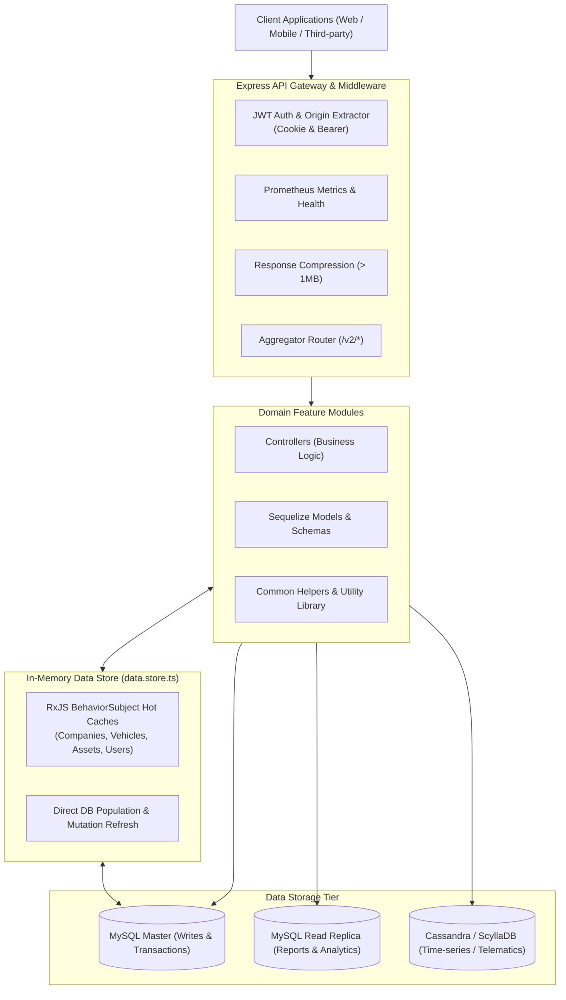
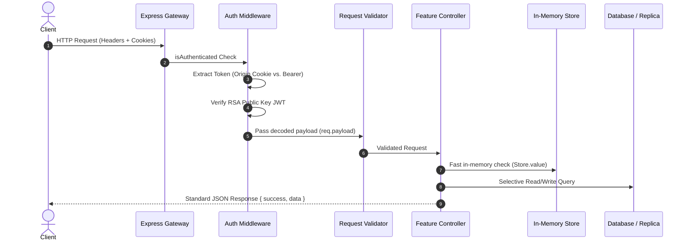

# API Service Architecture & Handover Guide
*A complete architectural blueprint and engineering standard based on the `apiservice-newstructure` production design pattern.*

---

## 1. Executive Architecture Overview

This document serves as an engineering handover for building a new, high-performance API service that mirrors the architecture, folder structure, performance optimizations, and coding standards of `apiservice-newstructure`.

The architecture is built for:
- **Sub-millisecond read responses** via lightweight in-memory caching (`RxJS BehaviorSubject`) loaded directly from the database on startup and refreshed on mutations.
- **Dedicated persistence tier** separating relational transactional data (MySQL/Sequelize) and optional high-throughput time-series data (Cassandra/ScyllaDB).
- **High throughput & reliability** using read/write connection pooling and dedicated read replicas for analytical queries.
- **Modular feature co-location** where each domain module encapsulates its own routes, controller, model, and unit tests.
- **Clean modular routing** using direct, type-safe TypeScript router imports and standard middleware chaining.



---

## 2. Directory & File Organization Standards

The codebase uses domain-driven directory organization. Rather than grouping all controllers or all models together in top-level directories, related features live together in sub-modules.

```
project-root/
│
├── src/
│   ├── app.ts                         # Express application entry, global middlewares, metrics, Swagger
│   ├── router.ts                      # Central v2 route aggregator mounting domain routers
│   ├── middleware.ts                  # JWT validation, origin check, token extraction
│   ├── data.store.ts                  # RxJS BehaviorSubject in-memory cache populated from DB
│   ├── orm.ts                         # Sequelize primary write connection & read replica pool
│   ├── database.ts / config.ts        # Raw database connection pool configuration
│   ├── cassandra.ts / scyllaDB.ts     # Cassandra / ScyllaDB time-series client configuration
│   ├── common.helper.ts               # Core utility library (math, pagination, geo, formatters)
│   ├── requestValidator.ts            # Request payload and parameter validation
│   ├── metrics.ts                     # Prometheus metrics definitions (durations, active reqs, pool)
│   ├── helpers/
│   │   └── common.ts                  # Shared low-level file upload and object sanitation helpers
│   │
│   ├── core/                          # Core system domain
│   │   ├── company/
│   │   │   ├── company.router.ts      # HTTP endpoints for companies
│   │   │   ├── company.controller.ts  # Request handler & business logic
│   │   │   ├── company.model.ts       # Sequelize schema & model methods
│   │   │   └── company.test.ts        # Co-located unit tests (Mocha/Chai/Sinon)
│   │   ├── user/
│   │   ├── department/
│   │   └── useractivity/
│   │
│   ├── warehouse/                     # Warehouse & Assets domain
│   │   ├── assets/
│   │   │   ├── assets.router.ts
│   │   │   ├── assets.controller.ts
│   │   │   ├── assets.model.ts
│   │   │   └── assets.test.ts
│   │   └── assetcategory/
│   │
│   ├── vehicle/                       # Telematics & Fleet domain
│   │   ├── vehicle/
│   │   ├── gps/
│   │   └── alert/
│   │
│   └── service/ / maintenance/        # Auxiliary functional domains
│
├── run_all_tests.ts                   # Fast, recursive test runner (Mocha/ts-node)
├── tsconfig.json                      # TypeScript compiler settings
├── package.json                       # Dependencies & scripts
└── .env                               # Environment configurations
```

### Module Co-location Rule
Every functional capability is encapsulated in a dedicated folder containing four standard files:
1. `<domain>.router.ts`: Route definitions and middleware binding.
2. `<domain>.controller.ts`: Input parsing, orchestration, error handling, JSON responses.
3. `<domain>.model.ts`: Database table definitions, relations, and low-level data access methods.
4. `<domain>.test.ts`: Isolated unit tests covering happy paths, edge cases, and failure modes.

---

## 3. In-Memory Data Store & Fast Response Pattern

### The Problem It Solves
High-frequency endpoints (e.g. live maps, telemetry lookups, authorization checks) should not query MySQL repeatedly for static or semi-static metadata (such as company settings, asset profiles, or vehicle master records).

### The In-Memory Architecture (`data.store.ts`)
1. **RxJS BehaviorSubjects**:
   Each entity domain maintains an in-memory cache:
   ```typescript
   import { BehaviorSubject } from "rxjs";

   export let companies = new BehaviorSubject<any[]>([]);
   export let assets = new BehaviorSubject<any[]>([]);
   export let vehicles = new BehaviorSubject<any[]>([]);
   ```

2. **Sub-millisecond Lookups**:
   Controllers read directly from memory without database round-trips:
   ```typescript
   // Instant in-memory lookup instead of querying MySQL
   const company = companies.value.find((c: any) => c.id === companyID);
   const matchingAssets = assets.value.filter((a: any) => a.CompanyID === companyID);
   ```

3. **Database Population & Mutation Refresh**:
   - On application startup, data stores load current state directly from MySQL:
     ```typescript
     export const populateCompanies = async () => {
       const data = await Company.findAll({ where: { Status: '1' } });
       companies.next(data);
     };

     export const populateAssets = async () => {
       const data = await Asset.findAll({ where: { Status: '1' } });
       assets.next(data);
     };
     ```
   - When a record is created, updated, or deleted in a controller, the corresponding populate function is triggered asynchronously to refresh the in-memory cache:
     ```typescript
     // Inside company.controller.ts after save
     await Company.update(payload, { where: { id } });
     populateCompanies(); // non-blocking refresh
     ```

---

## 4. Database Performance & Resource Optimization

### Dual-Connection Architecture (Write vs. Read Replica)
To prevent analytical reports from starving transactional queries, the service defines two distinct Sequelize connection pools in `src/orm.ts`:

| Instance | Environment Config | Purpose |
| :--- | :--- | :--- |
| **`sequelize`** (Primary) | `DB_MYSQL_HOST`, `DB_MYSQL_DBNAME` | Writes, transactions, active mutations, critical path reads. |
| **`sequelizeReport`** (Replica) | `DB_MYSQL_READ_HOST`, `DB_MYSQL_READ_DBNAME` | Large paginated lists, CSV/Excel exports, history reports. |

### Connection Pool Configuration
Never rely on default database driver connection allocations. Both instances define explicit pool constraints:
```typescript
pool: {
  max: parseInt(process.env.DB_MYSQL_POOL_MAX || "20"),
  min: parseInt(process.env.DB_MYSQL_POOL_MIN || "5"),
  acquire: parseInt(process.env.DB_MYSQL_POOL_ACQUIRE || "30000"), // 30s timeout
  idle: parseInt(process.env.DB_MYSQL_POOL_IDLE || "10000")        // 10s idle release
}
```

### Persistence Tier Separation
- **MySQL (Primary Relational Store)**: Master metadata, companies, users, permissions, assets, configurations.
- **Cassandra / ScyllaDB (Optional Time-Series)**: High-speed ingestion of IoT sensor data, GPS historical tracks, and alert logs to keep the relational database lean and performant.

### Response Compression
Response payload compression is enabled globally via `compression()` middleware for payloads exceeding 1MB:
```typescript
app.use(compression({ threshold: 1 * 1024 * 1024 }));
```

---

## 5. Clean Modular Routing Pattern

In this architecture, routers are organized cleanly using standard TypeScript ES module imports. Domain routers are mounted onto the central router aggregator (`src/router.ts`) with clear route prefixes and explicit middleware chains.

### Central Router Architecture (`src/router.ts`)
```typescript
import * as express from "express";
const router = express.Router();

// Middlewares
import { isAuthenticated } from "./middleware";

// Standard Domain Router Imports
import UserRouter from "./core/user/user.router";
import CompanyRouter from "./core/company/company.router";
import AssetRouter from "./warehouse/assets/assets.router";
import VehicleRouter from "./vehicle/vehicle/vehicle.router";
import SubscriptionRouter from "./subscription/subscription.router";

// Route Declarations with Middleware Chaining
router.use("/user", UserRouter);
router.use("/company", isAuthenticated, CompanyRouter);
router.use("/assets", isAuthenticated, AssetRouter);
router.use("/vehicle", isAuthenticated, VehicleRouter);
router.use("/subscription", isAuthenticated, SubscriptionRouter);

export default router;
```

### Route Design Principles
1. **Explicit Middleware Chaining**: Common protection like `isAuthenticated` is applied at the mount level on the router aggregator, keeping individual feature route files clean.
2. **RESTful Standard Endpoints**: Each feature router exposes clear verbs and paths:
   - `GET /` or `GET /list`: Retrieve list of resources with query params.
   - `GET /details?ID=...`: Retrieve single resource details.
   - `POST /save`: Create or upsert a resource.
   - `GET /delete?ID=...` or `DELETE /:id`: Delete resource.

---

## 6. Authentication & Request Lifecycle



### Multi-Origin Token Extraction
The system supports dual frontend applications (e.g. Superadmin Portal vs. Customer App) using origin-matched secure HTTP-only cookies with fallback to standard Bearer tokens:
1. Checks `req.headers.origin`.
2. If origin matches `ADMIN_ORIGIN`: reads `sa_auth_token` cookie.
3. If origin matches `CLIENT_ORIGIN`: reads `auth_token` cookie.
4. Fallback: reads standard `Authorization: Bearer <JWT>` header.

### Standard Response Format
All controller methods adhere to a uniform JSON response contract:
```typescript
// Successful Response
res.status(200).json({
  success: true,
  data: resultData,
  message: "Operation completed successfully" // optional
});

// Handled Error Response
res.status(400 | 500).json({
  success: false,
  message: error.message || "An unexpected error occurred"
});
```

---

## 7. Common Helper & Utility Standards (`common.helper.ts`)

Standard functions are centralized rather than reimplemented inside controllers:

1. **In-Memory Pagination (`setPaginate`)**:
   Standard slice and pagination for in-memory arrays:
   ```typescript
   export const setPaginate = (array: any[], page: number, limit: number) => {
     const offset = (page - 1) * limit;
     return array.slice(offset, offset + limit);
   };
   ```
2. **Object Sanitization (`clean`, `nullToEmpty`)**:
   Strips `null` and `undefined` properties before passing data to Sequelize or external APIs.
3. **Timezone Conversion (`localTimeToUTCWithOffset`, `getStartEndTimeZone`)**:
   Standardized timestamp calculations across Saudi Arabia (`Asia/Riyadh`) and UTC using `moment-timezone`.
4. **Geo & Polygon Computations**:
   Using `geolib` and `@turf/turf` for geofencing, distance calculation, and point-in-polygon verification (`checkInsideZone`).

---

## 8. Unit Testing & Continuous Verification Standard

### Co-Located Unit Testing Rule
- Every file `src/<path>/<name>.ts` must be accompanied by `src/<path>/<name>.test.ts`.
- Code changes are not complete until tests pass with **zero regressions**.

### Test Runner Architecture (`run_all_tests.ts`)
The project utilizes a dedicated recursive test execution script:
```bash
# Run all unit tests
npx ts-node --transpile-only run_all_tests.ts

# Filter tests by module keyword
npx ts-node --transpile-only run_all_tests.ts company
npx ts-node --transpile-only run_all_tests.ts assets
```

### Mocking Best Practices
- **Mocha** for test orchestration (`describe`, `it`, `beforeEach`).
- **Chai** for BDD assertions (`expect(...)`).
- **Sinon** for test doubles:
  - Stub `dataStore.companies.value` and `dataStore.assets.value` to supply mock data in tests without hitting MySQL.
  - Set `process.env.SKIP_DATA_STORE_POPULATE = 'true'` during test setup to prevent background database sweeps.

---

## 9. Project Checklist for New API Service Setup

Use this checklist when scaffolding a new service using this pattern:

- [ ] **TypeScript Setup**: Strict compiler config with `noImplicitAny: false` for rapid evolution, module resolution `node`.
- [ ] **ORM Configuration**: Define master `sequelize` and read-only `sequelizeReport` instances with explicit connection pooling.
- [ ] **Data Store Setup**: Create `data.store.ts` with RxJS `BehaviorSubject` populated directly from MySQL queries on startup and refreshed on mutations.
- [ ] **Gateway & Central Router**: Build `app.ts` and `router.ts` mounting modular domain routers with standard TypeScript imports.
- [ ] **Security Middlewares**: Configure Helmet, CORS with dynamic origin whitelisting, and RSA-based JWT authentication.
- [ ] **Prometheus Metrics**: Expose `/metrics` tracking active requests, latencies, and DB connection pool state.
- [ ] **Co-located Testing**: Set up `run_all_tests.ts` with Mocha, Chai, and Sinon.
